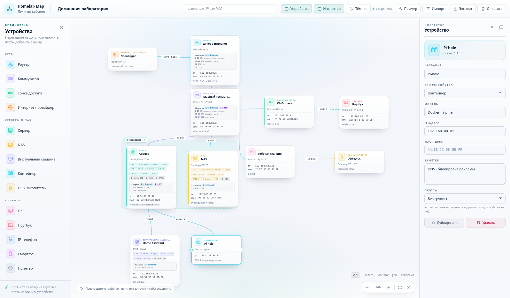

# Homelab Map

Конструктор схем сети для homelab и небольших офисов. Собирайте диаграмму из роутеров, коммутаторов, серверов, NAS и клиентских устройств, подписывайте модели, IP и MAC-адреса, соединяйте устройства линиями.



## Возможности

- Библиотека устройств: роутер, коммутатор, точка доступа, сервер, NAS, ПК, ноутбук, IP-телефон, смартфон, принтер.
- Перетаскивание устройств из левой панели на холст или добавление по клику в центр.
- Карточки с названием, моделью, IP- и MAC-адресом, заметками.
- Соединения между устройствами: потяните за точку на карточке и отпустите на другом устройстве.
- Типы связей: Ethernet, оптика/DAC, Wi-Fi (пунктир), USB/прочее, VPN-туннель с протоколом L2TP/IPsec, OpenVPN или WireGuard, плюс подпись на линии.
- Группы устройств: выделите несколько карточек через Shift/Ctrl/Cmd + клик, нажмите «Объединить в группу» и перетаскивайте группу за заголовок. Цвет и название настраиваются в инспекторе.
- Светлая и тёмная темы с переключателем в верхней панели; выбор сохраняется в браузере.
- Перемещение карточек, панорамирование фона и масштабирование.
- Автосохранение в `localStorage`, экспорт и импорт схемы в JSON (включая группы).
- Горячие клавиши: `Delete` / `Backspace` — удалить, `Ctrl+D` — дублировать, `Esc` — снять выделение, `Shift/Ctrl/Cmd + клик` — выбрать несколько, `Ctrl + колесо` — масштаб.

## Запуск

```bash
npm install
npm run dev
```

Сборка:

```bash
npm run build
npm run preview
```

При первом запуске открывается демонстрационная схема домашней сети. Её можно заменить своей или нажать «Очистить».

## Стек

React 19, TypeScript, Vite. Диаграмма реализована без сторонних canvas-библиотек: SVG-связи, позиционирование карточек и drag-and-drop на pointer events.
