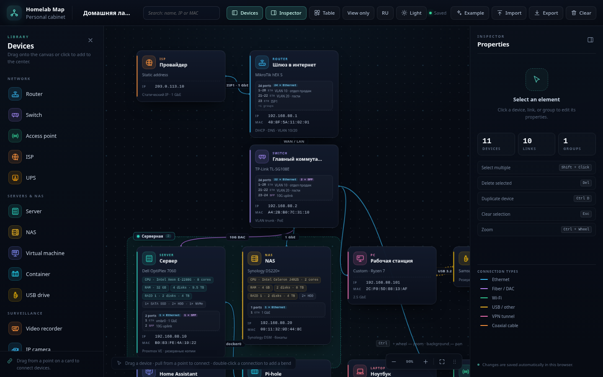
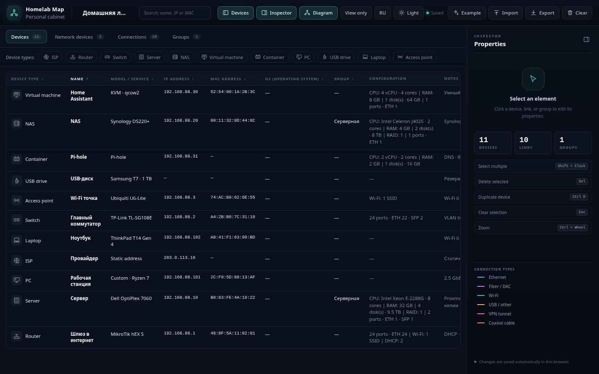
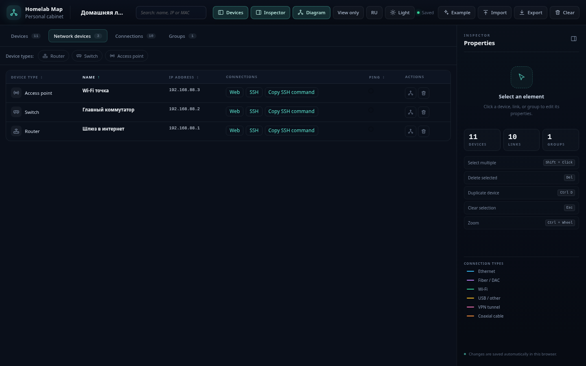

# Homelab Map

Конструктор схем сети для homelab и небольших офисов. Позволяет собирать диаграмму инфраструктуры из сетевых и клиентских устройств, настраивать параметры узлов и связей, вести мониторинг доступности и работать со схемой в визуальном и табличном режимах.

## Скриншоты



| Таблица устройств | Сетевые устройства |
| --- | --- |
|  |  |

## Возможности

### Устройства и диаграмма
- Библиотека устройств: роутер, коммутатор, точка доступа, сервер, NAS, ПК, ноутбук, неттоп, одноплатный компьютер, IP-телефон, смартфон, принтер, 3D-принтер, ВМ, контейнер, USB-накопитель, ИБП, видеорегистратор (DVR/NVR), IP/аналоговая камера, интернет-провайдер и «Другое».
- Перетаскивание устройств из панели на холст или добавление по клику.
- Карточки устройств с названием, моделью, IP/MAC, заметками и дополнительными параметрами (зависят от типа устройства).
- Соединения между устройствами: создание перетаскиванием от точки на карточке.
- Типы связей: Ethernet, оптика/DAC, Wi-Fi, USB/прочее, VPN-туннель (L2TP/IPsec, OpenVPN, WireGuard), коаксиальный кабель; подпись на линии.
- Гибкая маршрутизация связей: добавление изломов (waypoints) двойным кликом по линии, перетаскивание точек, удаление точки двойным кликом, сброс маршрута в инспекторе.
- Визуальное разделение пересекающихся линий (подложка/halo под связями) для лучшей читаемости схемы.
- Группы устройств: выделение нескольких элементов, объединение в группу, перенос группы целиком, настройка названия и цвета.
- Панорамирование, масштабирование, сетка, светлая/тёмная темы.
- Автосохранение в `localStorage`, импорт/экспорт схемы в JSON.

### Мониторинг и подключения
- **Ping-мониторинг** (для роутера, коммутатора, точки доступа, сервера, NAS, ВМ, видеорегистратора):
  - включается переключателем в инспекторе;
  - сервер периодически проверяет доступность устройства по IP (примерно раз в 2–3 минуты);
  - на карточке устройства отображается индикатор статуса (отвечает / не отвечает / неизвестно).
- **Подключения из инспектора** (для роутера, коммутатора, точки доступа, NAS):
  - web-ссылка для открытия интерфейса устройства (http/https, IP или DNS, порт);
  - SSH-подключение (`ssh://`, пользователь, адрес, порт) + кнопка копирования команды SSH.

### Табличный режим
- Переключение между схемой и таблицей.
- Разделы: устройства, **сетевые устройства**, связи, группы.
- Раздел **«Сетевые устройства»** (роутеры, коммутаторы, точки доступа):
  - колонки: тип, имя, IP, подключения (web/SSH ссылки и копирование SSH-команды), ping-индикатор, действия;
  - фильтрация по типам устройств (в т.ч. множественный выбор);
  - поиск и сортировка.

### Горячие клавиши
- `Delete` / `Backspace` — удалить выделенное
- `Ctrl+D` — дублировать устройство
- `Esc` — снять выделение
- `Shift/Ctrl/Cmd + клик` — множественное выделение
- `Ctrl + колесо` — масштаб

## Запуск

### Разработка (UI)
```bash
npm install
npm run dev
```

### Разработка с ping-мониторингом
Для работы ping нужен локальный API-сервер (выполняет ICMP-проверки на стороне сервера):

```bash
npm run dev:api   # сервер/API на http://localhost:8787
npm run dev       # Vite (проксирует /api на :8787)
```

### Сборка
```bash
npm run build
npm run preview
```

`npm run preview` обслуживает только статическую сборку; для ping в production-режиме используйте Node-сервер:

```bash
npm run build
npm start
```

### Docker
```bash
docker compose up --build
# или
make docker-up
```

В Docker-контейнере используется Node-сервер (`server/index.mjs`), который отдаёт `dist` и endpoint `/api/ping`. Для ICMP в `docker-compose.yml` добавлен `cap_add: NET_RAW`.

## Стек

- React 19, TypeScript, Vite
- i18next/react-i18next (локализация интерфейса)
- Node.js сервер для ping API и раздачи production-сборки
- Диаграмма реализована без сторонних canvas-библиотек: SVG-связи, позиционирование карточек и drag-and-drop на pointer events

При первом запуске открывается демонстрационная схема. Её можно заменить своей или очистить холст.
